# End-to-End E-Commerce ETL & BI Pipeline


An end-to-end data engineering and business intelligence pipeline built using the **Olist Brazilian E-Commerce dataset**. The project processes approximately 100,000 orders across nine relational source datasets using **PySpark**, organizes data through a **Bronze → Silver → Gold Medallion Architecture**, stores analytical datasets in **Snappy-compressed Parquet** on Amazon S3, exposes curated data through **Amazon Athena**, and delivers business insights through interactive **Power BI dashboards**.

The pipeline focuses on reliable ingestion, explicit schemas, data cleansing, referential-integrity checks, dimensional modeling, financial reconciliation, and cost-conscious cloud analytics.

The Gold layer contains a reporting-oriented star schema with **four fact tables and five dimension tables**, designed to preserve the grain of different business events and prevent incorrect aggregations.

**GitHub Repository:** [kousumi04/E-Commerce-Platform-Olist-Data-Lakehouse](https://github.com/kousumi04/E-Commerce-Platform-Olist-Data-Lakehouse)

---

## Table of Contents

- [Project Overview](#project-overview)
- [Objectives and Engineering Highlights](#objectives-and-engineering-highlights)
- [Architecture Overview](#architecture-overview)
- [End-to-End ETL Pipeline](#end-to-end-etl-pipeline)
- [Medallion Architecture](#medallion-architecture)
- [Data Ingestion](#data-ingestion)
- [Data Cleaning and Validation](#data-cleaning-and-validation)
- [Gold Layer: Dimensional Modeling](#gold-layer-dimensional-modeling)
- [Amazon S3 Data Lake](#amazon-s3-data-lake)
- [Amazon Athena and SQL Analytics](#amazon-athena-and-sql-analytics)
- [Athena Analytical Query Results](#athena-analytical-query-results)
- [Power BI Dashboards](#power-bi-dashboards)
- [Technology Stack](#technology-stack)
- [Repository Structure](#repository-structure)
- [Installation and Setup](#installation-and-setup)
- [AWS Configuration](#aws-configuration)
- [Data Quality and Reconciliation](#data-quality-and-reconciliation)
- [Cost-Conscious Design](#cost-conscious-design)
- [Limitations](#limitations)

---

## Project Overview

E-commerce platforms generate data across multiple business processes. Customers place orders, sellers list products, order items are fulfilled, payments are processed, reviews are submitted, and deliveries are completed.

These events are represented in separate relational datasets and are not immediately suitable for consolidated business reporting.

This project transforms the Olist source data into a structured analytical environment.

PySpark performs extraction and transformation, Parquet provides an efficient columnar storage format, Amazon S3 stores the data lake layers, and Amazon Athena provides serverless SQL access to curated datasets.

Power BI consumes the analytical model to present business performance through interactive dashboards.

### Dataset

The project uses the [Olist Brazilian E-Commerce Public Dataset](https://www.kaggle.com/datasets/olistbr/brazilian-ecommerce).

The dataset contains approximately 100,000 orders and multiple related datasets covering:

- Customers
- Orders
- Order items
- Products
- Sellers
- Payments
- Reviews
- Geolocation
- Product category translations

The source files are handled as nine separate CSV datasets. Explicit Spark schemas are used to control data types and avoid unwanted type inference.

### High-Level Data Flow

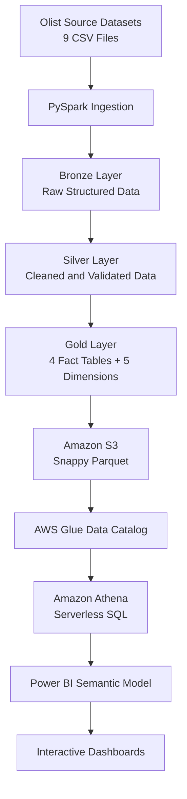

---

## Objectives and Engineering Highlights

| Area | Implementation | Outcome |
|---|---|---|
| Data ingestion | PySpark with explicit schemas | Consistent ingestion of nine source datasets |
| Data organization | Bronze, Silver, and Gold layers | Separation of raw, cleaned, and analytical data |
| Data cleansing | PySpark transformations | Standardized and deduplicated datasets |
| Data quality | Automated validation and reconciliation | Checks for uniqueness, integrity, and financial consistency |
| Data modeling | Four fact tables and five dimensions | Analytics-ready star schema |
| Storage | Snappy-compressed Parquet on Amazon S3 | Columnar storage with reduced footprint |
| SQL analytics | Amazon Athena | Serverless querying of curated datasets |
| Business intelligence | Power BI Import Mode | Interactive business dashboards |
| Cost governance | Manual Athena DDL and query scan guardrail | Reduced dependence on paid cataloging and unnecessary query scans |

### Engineering Highlights

- **Medallion Architecture:** Separates raw ingestion, data quality transformations, and business-facing data models.
- **Explicit Schema Enforcement:** Uses Spark schemas to preserve identifiers and correctly parse source fields.
- **Geolocation Optimization:** Consolidates more than one million raw geolocation records into a unique postal-code-prefix lookup dataset.
- **Grain-Aware Modeling:** Separates orders, order items, payments, and reviews into independent fact tables.
- **Data Quality Checks:** Validates primary-key uniqueness and foreign-key relationships.
- **Financial Reconciliation:** Compares key financial totals across source data, Gold Parquet, and Athena.
- **Columnar Storage:** Uses Snappy-compressed Parquet to reduce storage size and improve analytical scan efficiency.
- **Cost-Aware Querying:** Uses manually defined external tables and an Athena workgroup scan limit.

---

## Architecture Overview

The solution is organized into four logical areas:

1. Data processing
2. Data storage
3. Query serving
4. Business intelligence

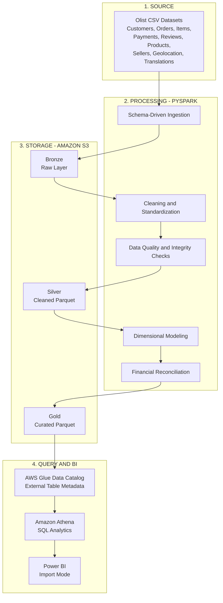

### Architecture Responsibilities

| Component | Responsibility |
|---|---|
| Olist CSV files | Original relational source data |
| PySpark | Data processing, schema enforcement, transformations, and modeling |
| Bronze layer | Raw source archive |
| Silver layer | Cleaned, standardized, and validated records |
| Gold layer | Business-oriented facts and dimensions |
| Amazon S3 | Object storage for data lake layers |
| AWS Glue Data Catalog | Stores table definitions and metadata |
| Amazon Athena | Executes SQL queries directly against S3 data |
| Power BI | Builds the semantic model, DAX measures, and dashboards |

---

## End-to-End ETL Pipeline

The pipeline moves data through a sequence of controlled stages. Each stage has a defined input, transformation responsibility, and output.

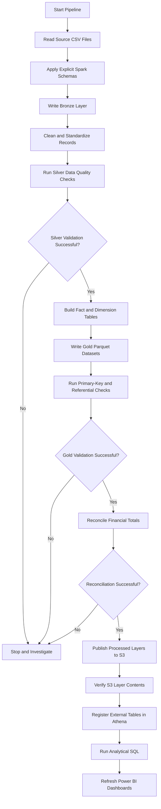

### Stage 1: Source Extraction

The pipeline starts with the nine Olist CSV files. The files are read using PySpark.

Explicit schemas are used instead of relying entirely on automatic inference. This is important for fields that may look numeric but are identifiers, such as Brazilian postal-code prefixes.

These identifiers must remain strings so that leading zeros are not lost.

The review dataset also requires CSV parsing settings that support embedded newlines and escaped quotation marks in review comments.

**Output:** Source records loaded into Spark DataFrames with controlled column types.

### Stage 2: Bronze Ingestion

The Bronze layer is the first structured representation of the source datasets.

Its purpose is to retain ingested data in a consistent format while keeping it separate from downstream cleansing logic.

The pipeline writes the source datasets to the Bronze S3 prefix as CSV in the documented implementation.

**Output:** Raw source datasets stored under the Bronze/raw S3 location.

### Stage 3: Silver Transformations

The Silver layer applies the cleaning and standardization rules required for reliable downstream analysis.

Typical operations include:

1. Removing duplicate records using relevant business keys.
2. Converting date and timestamp columns to appropriate Spark types.
3. Standardizing selected text fields.
4. Filtering invalid financial values, such as non-positive item prices or payment values and negative freight values.
5. Preserving identifiers as strings where formatting is meaningful.
6. Cleaning geolocation data and reducing it to a unique row per postal-code prefix.
7. Checking primary-key uniqueness and foreign-key relationships.

The cleaned datasets are written in Snappy-compressed Parquet format.

**Output:** Validated and standardized Silver datasets.

### Stage 4: Gold Dimensional Modeling

The Gold layer converts the cleaned relational datasets into a business-facing analytical model.

The project uses four fact tables to represent different business events:

- Orders
- Order line items
- Payment transactions
- Reviews

Five dimension tables provide descriptive context:

- Date
- Customers
- Products
- Sellers
- Geolocation

Separating facts by grain prevents a common analytical problem: joining multiple one-to-many relationships and accidentally multiplying revenue, payment, order, or review values.

**Output:** Nine curated Gold Parquet tables.

### Stage 5: Reconciliation and Publication

After Gold generation, the pipeline performs end-to-end financial reconciliation.

Key metrics are compared between the raw source data, curated Gold outputs, and Athena query results.

Once local processing and validation are complete, the Silver and Gold layers are uploaded to Amazon S3 using the project's Boto3-based upload utility.

A separate verification process audits the expected layer structure and uploaded objects.

**Output:** Validated Silver and Gold datasets available in S3.

### Stage 6: SQL Serving and Business Intelligence

The Gold Parquet files are exposed through manually created external table definitions in the AWS Glue Data Catalog.

Amazon Athena uses these definitions to query the files in S3 without requiring a provisioned database server.

Power BI connects through Athena in Import Mode. The imported model uses relationships and centralized DAX measures to power the report pages.

**Output:** SQL-accessible Gold tables and interactive Power BI dashboards.

---

## Medallion Architecture

The data lake follows the Medallion Architecture pattern. Each layer represents a different level of data refinement, from source preservation to analytical readiness.

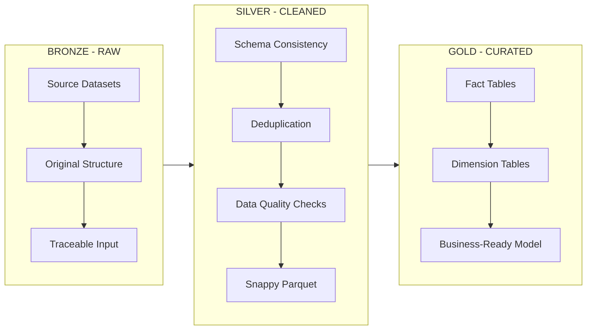

### Layer Comparison

| Layer | Technology | S3 Location | Format | Responsibility |
|---|---|---|---|---|
| Bronze | PySpark / AWS S3 | `raw/` | CSV (~120 MB) | Raw source archive |
| Silver | PySpark | `processed/cleaned_data/` | Snappy Parquet | Schema enforcement, deduplication, and integrity checks |
| Gold | PySpark / Boto3 | `curated/` | Snappy Parquet (~20 MB) | Four fact tables and five dimensions |
| Serving | Amazon Athena | Database: `ecommerce_dw` | Serverless SQL | SQL analytics |
| BI | Power BI | Report layer | Import Mode | Interactive dashboards |

### Bronze: Source Preservation

Bronze is the raw ingestion boundary. It keeps the source datasets separate from the business rules applied later in the pipeline.

The original source files are retained locally in the raw input directory. The Bronze S3 prefix provides the raw archive used by the cloud data lake.

### Silver: Standardized and Trustworthy Data

Silver applies the rules needed to make the source datasets consistent and suitable for modeling.

The layer includes:

- Explicit and consistent data types.
- Duplicate removal using relevant keys.
- Timestamp conversion.
- Text standardization where applicable.
- Validation of financial values.
- Geolocation filtering and aggregation.
- Referential-integrity checks.

### Gold: Business-Ready Analytical Data

Gold is the consumption layer. It contains the fact and dimension tables used by Athena and Power BI.

The Gold layer is optimized for analytical queries rather than transactional updates. It uses Parquet and Snappy compression to reduce storage and query scanning.

---

## Data Ingestion

### Source Datasets

The pipeline processes nine Olist source datasets:

| Dataset | Business Information |
|---|---|
| `olist_orders_dataset.csv` | Order lifecycle, status, and timestamps |
| `olist_order_items_dataset.csv` | Products, sellers, item prices, and freight |
| `olist_order_payments_dataset.csv` | Payment methods, installments, and payment values |
| `olist_order_reviews_dataset.csv` | Customer review scores, comments, and timestamps |
| `olist_customers_dataset.csv` | Customer identifiers and location attributes |
| `olist_products_dataset.csv` | Product attributes and category information |
| `olist_sellers_dataset.csv` | Seller identifiers and location attributes |
| `olist_geolocation_dataset.csv` | Brazilian postal-code geolocation records |
| `product_category_name_translation.csv` | Portuguese-to-English product category mapping |

### Schema Enforcement

Explicit Spark schemas help prevent inconsistent type inference and preserve the meaning of source fields.

**Brazilian postal codes**

Five-digit CEP prefixes are represented as strings. This preserves leading zeros and prevents identifiers from being treated as quantities.

**Review comments**

CSV parsing uses multiline support and quote escaping so that embedded newlines and quotation marks do not break record parsing.

---

## Data Cleaning and Validation

The Silver transformation stage applies dataset-specific rules rather than using one generic cleaning operation for every source.

### Geolocation Processing

The original geolocation source contains repeated GPS observations for the same postal-code prefix.

Joining this dataset directly to business tables can create many-to-many joins and significantly inflate row counts.

The pipeline:

1. Filters coordinates to valid Brazilian geographic bounds:
   - Latitude: `-35` to `6`
   - Longitude: `-75` to `-30`
2. Groups records by postal-code prefix.
3. Aggregates coordinates to one representative row per prefix.

This reduces the geolocation dataset from **1,000,163 raw rows to 19,011 cleaned rows**.

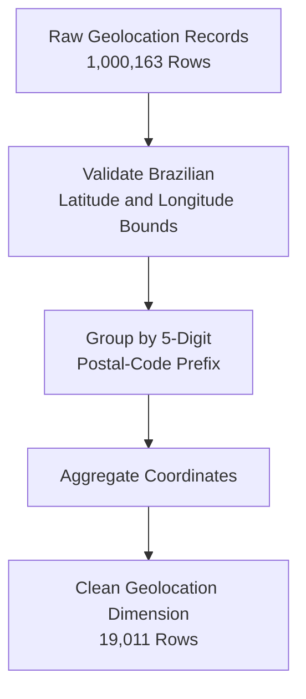

### Dataset-Level Cleansing Rules

| Dataset | Cleaning and Validation Logic |
|---|---|
| Orders | Convert date fields to timestamps and remove duplicate `order_id` records |
| Order items | Remove duplicate `(order_id, order_item_id)` records; require positive item prices and non-negative freight |
| Payments | Remove duplicate records and require positive payment values |
| Customers | Remove duplicate `customer_id` records |
| Products | Deduplicate using the relevant product key |
| Sellers | Deduplicate using the relevant seller key |
| Reviews | Remove duplicate records using the relevant review/order keys |
| Category translation | Deduplicate category translation records |
| Geolocation | Filter coordinates to Brazilian bounds and aggregate to one row per postal-code prefix |

### Data Quality Controls

The validation process checks:

- Primary-key uniqueness across all nine Silver datasets.
- Foreign-key relationships through left anti-joins.
- Referential integrity across the six modeled foreign-key relationships.
- Valid financial values and required identifiers.
- Geolocation uniqueness at postal-code-prefix grain.

---

## Gold Layer: Dimensional Modeling

The Gold layer follows a star-schema approach.

Fact tables store measurable business events, while dimensions provide the descriptive context needed to analyze those events.

### Why Separate Fact Tables?

Orders, order items, payments, and reviews do not have the same grain.

For example, one order can contain multiple order items and payment records, and it can be associated with a review.

Joining all these tables directly can multiply rows. A revenue total calculated after such a join may therefore be incorrect.

The project keeps these event types in independent fact tables. This allows each measure to be aggregated at its intended grain.

### Gold Model Overview

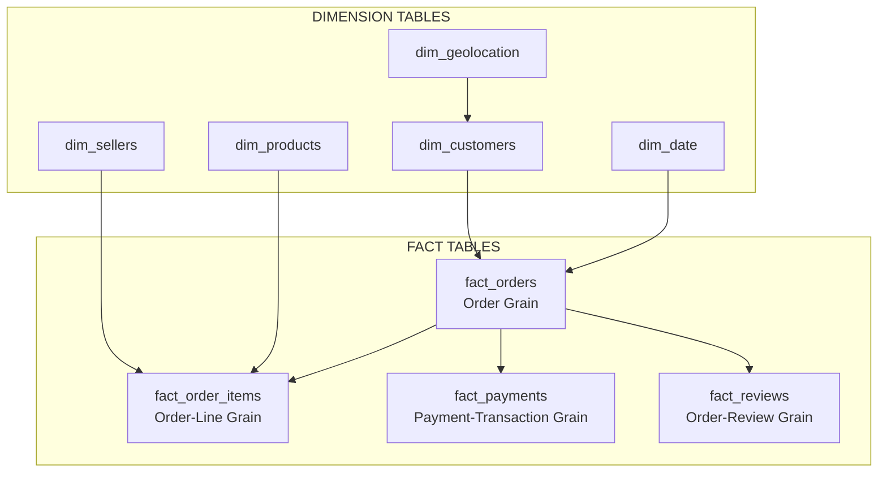

### Fact Tables

| Table | Grain | Row Count | Primary Key |
|---|---|---:|---|
| `fact_orders` | One row per order | 99,441 | `order_id` |
| `fact_order_items` | One row per order line item | 112,650 | `(order_id, order_item_id)` |
| `fact_payments` | One row per payment transaction | 103,886 | `(order_id, payment_sequential)` |
| `fact_reviews` | One row per order review | 99,224 | `(review_id, order_id)` |

### Dimension Tables

| Table | Grain | Row Count | Primary Key |
|---|---|---:|---|
| `dim_date` | One row per calendar day (2016–2019) | 1,461 | `date_key` (`YYYYMMDD` integer) |
| `dim_customers` | Order-level customer record | 99,441 | `customer_id` |
| `dim_products` | One row per product | 32,951 | `product_id` |
| `dim_sellers` | One row per seller | 3,095 | `seller_id` |
| `dim_geolocation` | One row per five-digit Brazilian zip prefix | 19,011 | `zip_code_prefix` |

### Entity Relationship Diagram

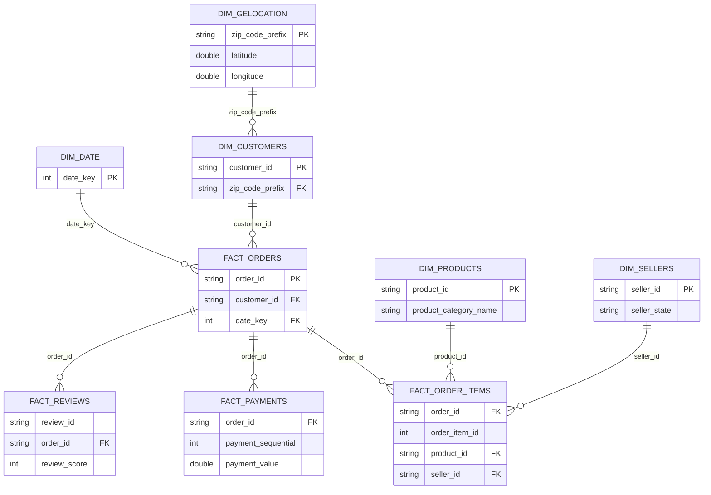

For detailed table definitions and the complete data model documentation, see [`docs/data_model.md`](docs/data_model.md).

---

## Amazon S3 Data Lake

Amazon S3 is used as the object-storage layer for the Medallion Architecture.

The project organizes data by layer so that raw, cleaned, and curated datasets remain logically separated.

### Logical Bucket Structure

```text
s3://<your-s3-bucket>/
│
├── raw/
│   └── ...                         # Bronze source archive
│
├── processed/
│   └── cleaned_data/
│       ├── ...                     # Silver Parquet datasets
│       └── ...
│
└── curated/
    ├── fact_orders/
    ├── fact_order_items/
    ├── fact_payments/
    ├── fact_reviews/
    ├── dim_date/
    ├── dim_customers/
    ├── dim_products/
    ├── dim_sellers/
    └── dim_geolocation/
```

The documented AWS region is `ap-south-1`.

### Storage Format and Compression

The Silver and Gold analytical layers use **Apache Parquet with Snappy compression**.

Parquet is a columnar file format. Instead of reading every field in a row-oriented file, an analytical engine can read only the columns required by a query.

This is particularly useful for BI workloads, where queries often select a small number of fields from large datasets.

Snappy compression reduces the physical storage footprint while keeping decompression efficient for analytical processing.

The documented Gold output is approximately **20 MB**, compared with approximately **120 MB** of raw CSV input.

---

## Amazon Athena and SQL Analytics

Amazon Athena provides serverless SQL access to the Gold Parquet datasets stored in S3.

It reads the files directly from S3 and uses table metadata from the AWS Glue Data Catalog to interpret their schemas.

The project uses manually defined external tables rather than paid Glue Crawlers. This keeps catalog registration explicit and avoids adding a crawler dependency to the workflow.

### Query-Serving Architecture

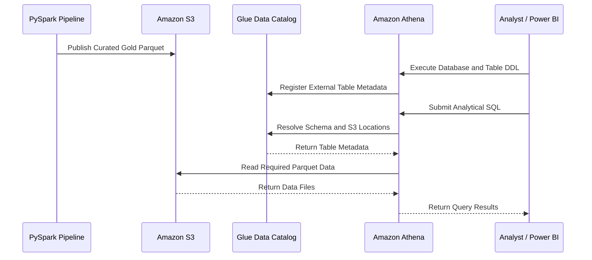

### Database and Tables

- **Database:** `ecommerce_dw`
- **Storage:** Gold Parquet datasets in Amazon S3
- **Catalog:** AWS Glue Data Catalog
- **Query Engine:** Amazon Athena
- **Table Definitions:** Manual external-table DDL

The nine Gold datasets exposed through Athena are:

| Table | Description |
|---|---|
| `fact_orders` | Order-level metrics and lifecycle information |
| `fact_order_items` | Item-level sales, product, seller, and freight information |
| `fact_payments` | Payment values, methods, and installments |
| `fact_reviews` | Customer review scores and timestamps |
| `dim_date` | Calendar attributes |
| `dim_customers` | Customer attributes and location |
| `dim_products` | Product attributes and categories |
| `dim_sellers` | Seller attributes and location |
| `dim_geolocation` | Postal-code geolocation attributes |

### Analytical Query Categories

The Athena analytical queries cover the following business areas:

| Query | Analytical Focus |
|---|---|
| Monthly Revenue & Month-over-Month Growth | Monthly revenue trends and MoM growth percentage |
| Overall Delivery KPIs | Delivery performance and operational KPIs |
| Payment Method Distribution & Average Installments | Payment preferences and installment behavior |
| Top 10 Brazilian States by Revenue & Unique Customers | Geographic revenue and customer distribution |
| Total Item GMV, Freight, and Average Order Value | Sales value, freight, and order economics |
| Unique Customers & Repeat Purchase Rate | Customer retention and repeat purchasing |

These queries demonstrate how the curated Gold model can be used for business analysis beyond the Power BI dashboards.

---

## Athena Analytical Query Results

The following screenshots show the analytical SQL outputs generated through **Amazon Athena**. They are query-result evidence, not Power BI dashboard screenshots.

### 1. Monthly Revenue and Month-over-Month Growth

Analyzes monthly revenue performance and calculates month-over-month growth.


### 2. Overall Delivery KPIs

Examines delivery performance and operational indicators to understand order fulfillment outcomes.


### 3. Payment Method Distribution and Average Installments

Analyzes customer payment preferences and installment behavior across payment methods.


### 4. Top 10 Brazilian States by Revenue and Unique Customers

Identifies the leading Brazilian states by revenue and unique customer count, supporting regional performance analysis.


### 5. Total Item GMV, Freight, and Average Order Value

Examines the relationship between merchandise value, freight charges, and average order value.


### 6. Unique Customers and Repeat Purchase Rate

Measures customer uniqueness and repeat purchase behavior to provide insight into customer retention.


### 7. Athena Table Creation

Screenshot documenting the Athena table creation process used to expose the curated datasets for SQL analysis.

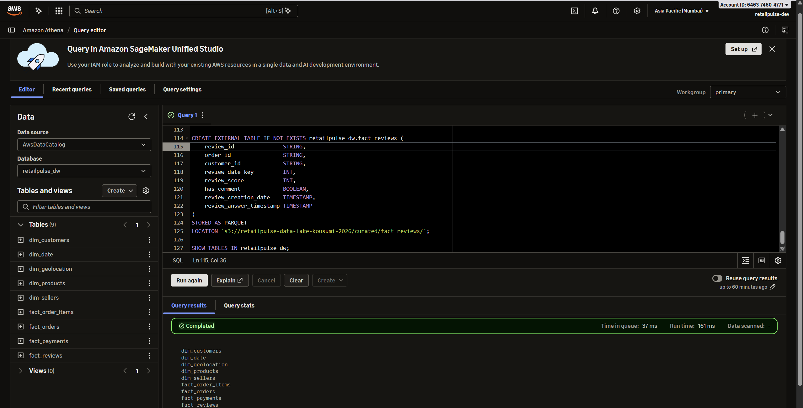

### 8. PowerBI Table Layout

Visual reference for the analytical table layout used in the query-serving layer.

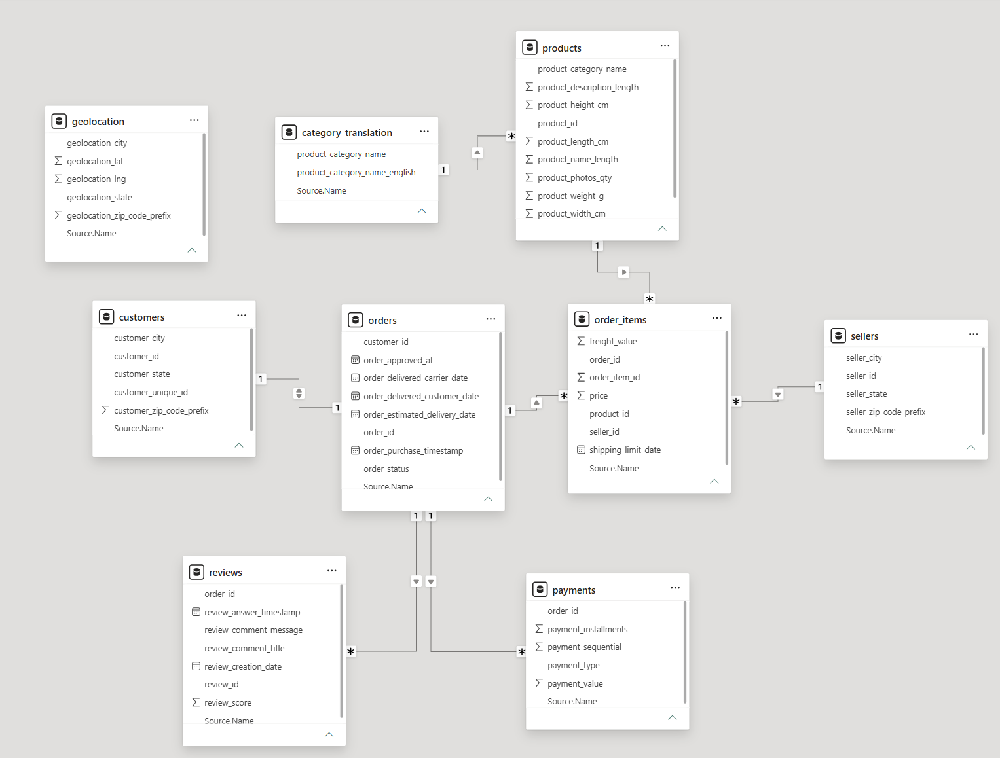

---

## Power BI Dashboards

Power BI connects to the Gold layer through Amazon Athena using **Import Mode**.

The semantic model uses single-direction, one-to-many relationships and a centralized `_Measures` DAX table.

The report follows a consistent matte-charcoal design system using:

- Background: `#121212`
- Visual surfaces: `#1F1F1F`

### Dashboard Navigation

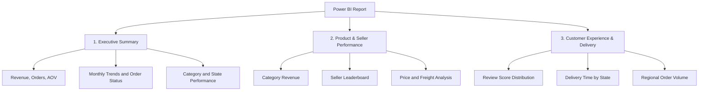

### 1. Executive Summary

**Key Metrics**

| Metric | Value |
|---|---:|
| Total Revenue | $13.59M |
| Total Orders | 99.44K |
| Average Order Value | $136.68 |
| Cancellation Rate | 0.6% |

**Visuals**

- Monthly revenue and order-volume trend using a dual-axis chart.
- Order fulfillment status donut chart, with 97.02% delivered.
- Top 10 product categories.
- Top 10 Brazilian states by revenue.

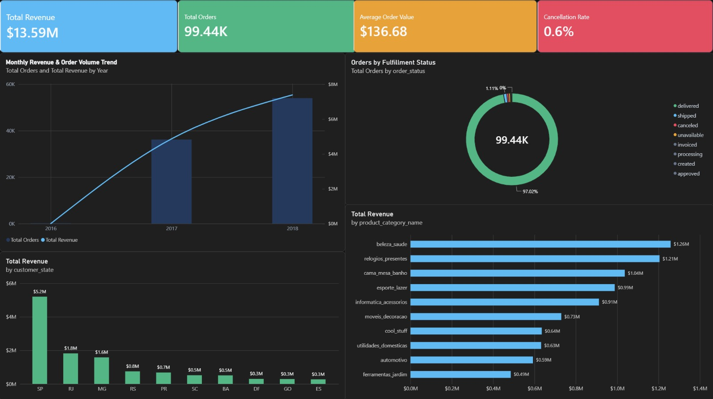

### 2. Product & Seller Performance

**Key Metrics**

| Metric | Value |
|---|---:|
| Total Revenue | $13.59M |
| Units Sold | 113K |
| Average Product Price | $120.65 |
| Average Freight Value | $19.99 |

**Visuals**

- Top 10 English product categories by revenue, including `health_beauty`, `watches_gifts`, and `bed_bath_table`.
- Top-performing sellers leaderboard matrix with conditional data bars.
- Category revenue versus average freight scatter plot.
- Product category and seller-state slicers.

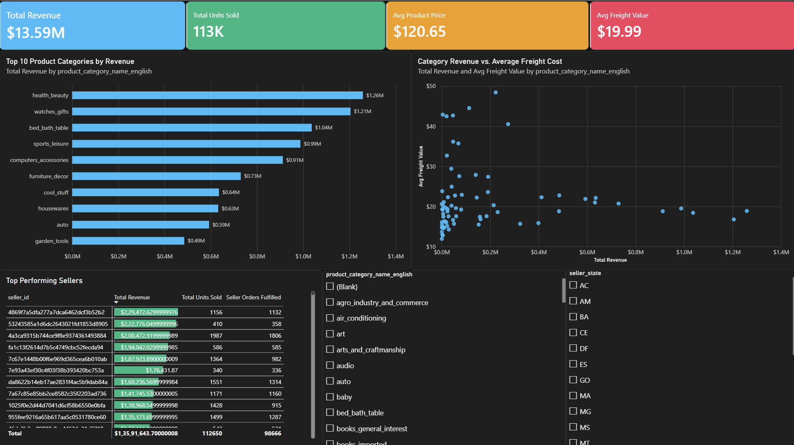

### 3. Customer Experience & Delivery Performance

**Key Metrics**

- Average delivery days.
- Average review score.
- On-time delivery rate.
- Total reviews.

**Visuals**

- Review-score distribution from one to five stars.
- Average delivery time by customer state.
- Regional order-volume map of Brazil.

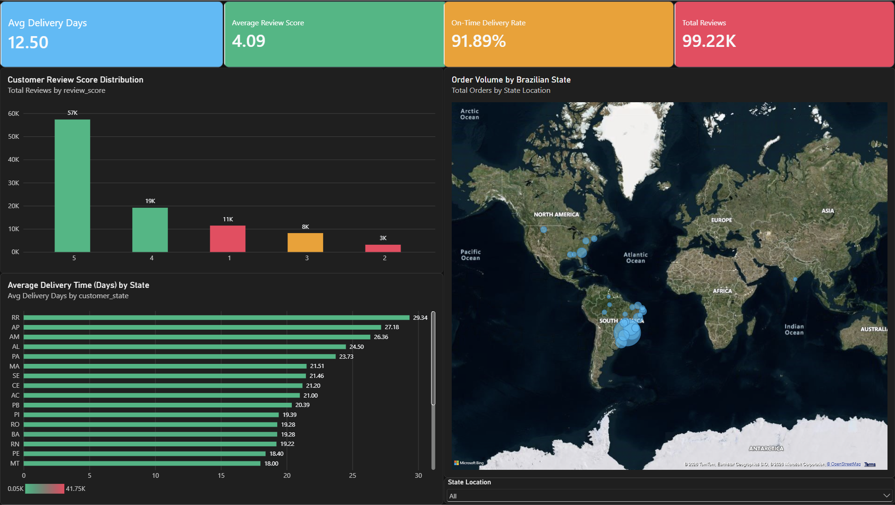

---

## Technology Stack

| Area | Technology | Responsibility |
|---|---|---|
| Programming Language | Python 3.12 | Pipeline orchestration, utilities, and data processing |
| Distributed Processing | Apache Spark / PySpark 3.5.9 | CSV ingestion, transformations, validation, and dimensional modeling |
| Storage Format | Apache Parquet + Snappy | Columnar storage and compression |
| Cloud Object Storage | Amazon S3 | Bronze, Silver, and Gold data storage |
| Metadata Catalog | AWS Glue Data Catalog | External table definitions and schema metadata |
| SQL Query Engine | Amazon Athena | Serverless SQL analytics |
| AWS SDK | Boto3 | Programmatic S3 upload and verification |
| BI and Visualization | Power BI Desktop | Semantic model, DAX measures, and dashboards |
| Query Language | SQL | Business analytics and Athena table definitions |
| Calculation Language | DAX | Power BI measures and reporting calculations |

---

## Repository Structure

The repository is organized into data, documentation, and execution scripts.

```text
E-Commerce-Platform-Olist-Data-Lakehouse/
│
├── data/
│
├── docs/
│   ├── images/
│   │   ├── Monthly Revenue & Month-over-Month (MoM) Growth %.png
│   │   ├── Overall Delivery KPIs.png
│   │   ├── Payment-Method-Dist-&-Avg-Installments.png
│   │   ├── Top-10-Brazilian-States-by-Revenue-&-Unique-Customers.png
│   │   ├── Total Item GMV, Freight, and Average Order Value (AOV).png
│   │   ├── Unique_Customers_&_Repeat_Purchase_Rate.png
│   │   ├── athena-tables-creation.png
│   │   ├── dashboard_1_executive.png.jpeg
│   │   ├── dashboard_2_product_seller.png
│   │   ├── CustomerExperience-d3.png
│   │   └── table-layout.png
│   │
│   ├── architecture.md
│   ├── data_dictionary.md
│   ├── data_model.md
│   └── data_quality_report.md
│
├── scripts/
│
└── README.md
```

### Documentation

| File | Description |
|---|---|
| `docs/architecture.md` | Architecture documentation and pipeline design |
| `docs/data_dictionary.md` | Dataset and field-level descriptions |
| `docs/data_model.md` | Fact tables, dimensions, and relationships |
| `docs/data_quality_report.md` | Data quality checks and validation results |
| `docs/images/` | Athena query outputs, dashboard screenshots, and technical visual references |

### Main Directories

- **`data/`** — Data-related project directory.
- **`docs/`** — Technical documentation and visual references.
- **`scripts/`** — Pipeline and utility scripts.
- **`README.md`** — Project overview, architecture, setup, and implementation details.

---

## Installation and Setup

### 1. Prerequisites

Install the following before running the pipeline:

- Python 3.12
- Java 17 (Eclipse Temurin JDK)
- AWS CLI v2
- An AWS account and IAM credentials with the required S3 permissions for cloud publication.
- The nine Olist CSV datasets downloaded from Kaggle.

The commands below use Windows Command Prompt syntax.

### 2. Clone the Repository

```cmd
git clone https://github.com/kousumi04/E-Commerce-Platform-Olist-Data-Lakehouse.git

cd E-Commerce-Platform-Olist-Data-Lakehouse
```

### 3. Create a Virtual Environment

```cmd
python -m venv .venv

.venv\Scripts\activate
```

### 4. Install Dependencies

If the repository contains a `requirements.txt` file:

```cmd
pip install -r requirements.txt
```

### 5. Prepare the Dataset

Download the [Olist Brazilian E-Commerce dataset](https://www.kaggle.com/datasets/olistbr/brazilian-ecommerce).

The pipeline requires these nine CSV files:

```text
data/
└── raw/
    ├── olist_customers_dataset.csv
    ├── olist_geolocation_dataset.csv
    ├── olist_order_items_dataset.csv
    ├── olist_order_payments_dataset.csv
    ├── olist_order_reviews_dataset.csv
    ├── olist_orders_dataset.csv
    ├── olist_products_dataset.csv
    ├── olist_sellers_dataset.csv
    └── product_category_name_translation.csv
```

Place the files in the input directory expected by the ingestion scripts.

### 6. Configure AWS

Configure your AWS CLI credentials using the IAM identity created for the project.

```cmd
aws configure
```

Provide:

- AWS Access Key ID
- AWS Secret Access Key
- Default region: `ap-south-1`
- Output format: `json`

Keep credentials outside the Git repository. Never commit access keys or secret keys.

### 7. Execute the Pipeline

The processing scripts are located in the `scripts/` directory.

Run the ingestion, transformation, validation, and modeling stages using the execution entry point provided in that directory.

The pipeline should complete local processing and validation before publishing datasets to S3.

Refer to the scripts and `docs/architecture.md` for the exact execution sequence and script arguments.

---

## AWS Configuration

### 1. Amazon S3

Create an S3 bucket in the configured AWS region:

`ap-south-1`

Use a globally unique bucket name and keep it consistent with the project configuration.

The bucket should contain the following logical prefixes:

```text
bucket-name/
│
├── raw/
│
├── processed/
│   └── cleaned_data/
│
└── curated/
    ├── fact_orders/
    ├── fact_order_items/
    ├── fact_payments/
    ├── fact_reviews/
    ├── dim_date/
    ├── dim_customers/
    ├── dim_products/
    ├── dim_sellers/
    └── dim_geolocation/
```

### 2. IAM Configuration

Use an IAM identity for the pipeline's programmatic S3 operations.

Grant the permissions required to:

- List the target bucket.
- Upload objects to the required prefixes.
- Inspect uploaded objects.
- Perform other operations explicitly required by the project's scripts.

Avoid using root-account access keys in local scripts.

Keep credentials in the AWS CLI profile or another secure credential provider.

### 3. AWS Glue Data Catalog

The AWS Glue Data Catalog stores the metadata required by Athena to interpret the Gold Parquet files.

The project uses manually defined external tables rather than Glue Crawlers.

This provides explicit control over table definitions while avoiding a crawler dependency.

### 4. Amazon Athena

Open the Athena Query Editor in the configured AWS region.

Create the database:

```sql
CREATE DATABASE IF NOT EXISTS ecommerce_dw;
```

Register the nine Gold datasets as external tables.

Each external table should point to its corresponding Gold S3 location and use the correct Parquet storage format.

The Athena workgroup should retain the documented **100 MB per-query data-scan guardrail**.

### 5. Power BI

Connect Power BI Desktop to Amazon Athena.

Configure the connection and import the curated Gold tables into the semantic model.

The report uses Import Mode, so dashboard interactions operate on the imported model rather than submitting a new Athena query for every interaction.

Refresh the model when the underlying Gold datasets change.

---

## Data Quality and Reconciliation

Data quality is treated as part of the pipeline rather than as a separate manual review step.

Validation is performed during transformation and again across the curated outputs.

### Validation Workflow

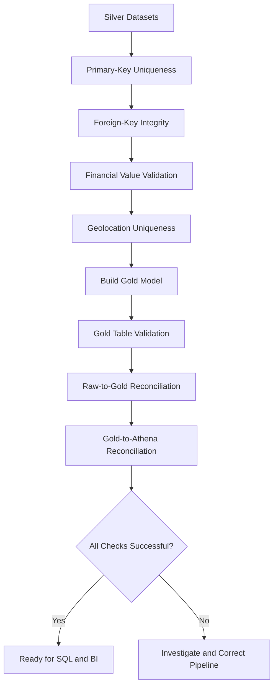

### Validation Results

| Check | Documented Result |
|---|---|
| Primary-key uniqueness | Zero duplicate primary keys across all nine Silver tables |
| Referential integrity | Zero orphan records across six foreign-key relationships |
| Geolocation aggregation | 1,000,163 raw records reduced to 19,011 cleaned records |
| Item GMV reconciliation | Exact 0.00 variance across raw, Gold Parquet, and Athena |
| Total payments reconciliation | Exact 0.00 variance across validated pipeline stages |
| Financial scope | Reconciliation performed across 99,441 orders |

### Financial Reconciliation

The pipeline checks that financial totals remain consistent as data moves from source datasets to the curated analytical model.

The documented Item GMV is approximately **$13.59M**.

The project verifies exact **0.00 variance** between the raw CSV data, curated Gold Parquet, and Athena for:

- Item GMV
- Total payments

The reconciliation covers 99,441 orders.

This is important because data-cleaning and join operations can unintentionally remove or multiply transactional records.

Reconciliation provides an end-to-end check that transformations have not changed the intended financial totals.

For detailed validation information, see [`docs/data_quality_report.md`](docs/data_quality_report.md).

---

## Cost-Conscious Design

The AWS components are configured to reduce unnecessary managed-service usage and query scanning.

| Design Choice | Cost-Control Purpose |
|---|---|
| Manual Athena external-table DDL | Avoids relying on paid Glue Crawlers for table discovery |
| S3-based Parquet storage | Uses object storage instead of a continuously running database |
| Snappy compression | Reduces the stored data footprint |
| Athena scan guardrail | Limits the amount of data scanned by an individual query |
| S3 lifecycle rules for query logs | Expires query logs according to the configured retention policy |
| Power BI Import Mode | Avoids repeatedly querying Athena for every dashboard interaction |

These measures are intended to make the architecture cost-conscious.

They do not guarantee zero AWS charges. Actual billing depends on service usage, account eligibility, region, storage, requests, and current AWS pricing.

---

## Limitations

- The pipeline is a batch ETL workflow based on the supplied Olist dataset; it is not a continuous real-time ingestion system.
- The source dataset represents a historical snapshot and does not automatically receive new orders.
- Power BI Import Mode requires a refresh to reflect changes in the underlying Gold datasets.
- Athena external tables describe data stored in S3; the Glue Data Catalog stores metadata, not the underlying Parquet files.
- The 100 MB Athena scan limit is a workgroup configuration and applies to queries executed under that workgroup.
- The documented row counts, financial totals, and storage sizes describe the current project run and may vary if the source data or transformation logic changes.
- The dataset must be downloaded separately and should not be committed to Git.
- AWS service charges may apply depending on account eligibility and usage.

---

## Project Summary

This project demonstrates an end-to-end analytical data workflow:

1. Ingesting relational source data using PySpark.
2. Transforming data through a Bronze, Silver, and Gold architecture.
3. Validating data quality and referential integrity.
4. Modeling business events at the correct grain.
5. Publishing curated Parquet datasets to Amazon S3.
6. Querying the data through Amazon Athena.
7. Performing business-oriented SQL analysis.
8. Building interactive Power BI dashboards.

The emphasis is on building a reproducible ETL process and a reliable analytical foundation for business intelligence.

---

## Repository

**GitHub:** [kousumi04/E-Commerce-Platform-Olist-Data-Lakehouse](https://github.com/kousumi04/E-Commerce-Platform-Olist-Data-Lakehouse)
